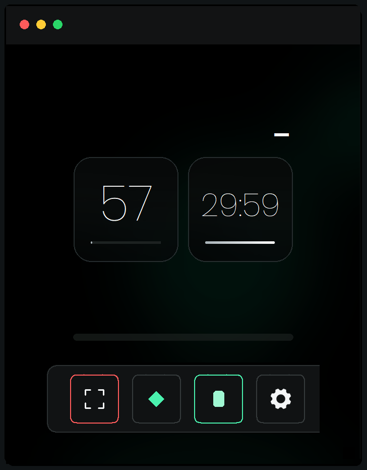
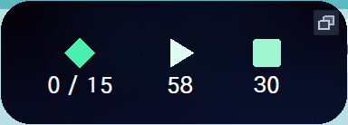
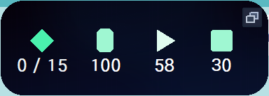
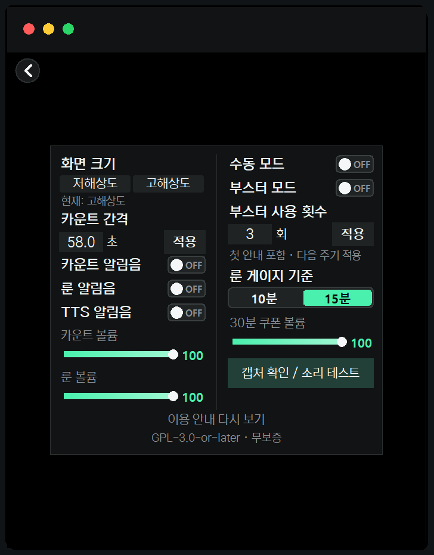
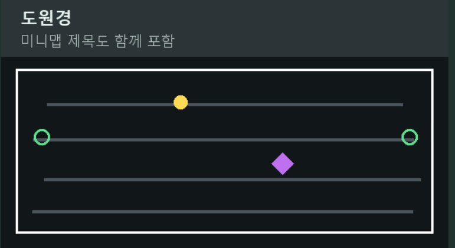

# 룬 타이머 · RuneTimer

메이플스토리 미니맵의 룬 표시를 감지해 소리로 알려주는 Windows용 프로그램입니다. 일반 카운터, 추가 30분 카운터, 부스터 사용 안내와 OBS 위젯을 함께 제공합니다.

## 다운로드

**[Windows 실행파일 ZIP 다운로드](https://github.com/LevineMaple/runetimer-desktop/releases/download/v1.1.5/RunTimer-Windows.zip)** · [릴리즈 및 소스](https://github.com/LevineMaple/runetimer-desktop/releases/tag/v1.1.5)

압축을 풀고 `RuneTimer.exe`를 실행하세요. 처음 사용하는 경우 알림 볼륨은 100이며, 기존 사용자의 저장된 설정은 유지됩니다.

## 주요 기능

- 미니맵 룬 감지와 음성 알림
- 메인 화면과 작은 OBS 위젯, 민트색 아이콘
- 기본 카운터와 선택적으로 추가하는 30분 카운터
- 룬 표시가 사라진 뒤 시작하는 자동 부스터 안내
- 캡처 확인, 소리 테스트, 미니맵 다시 찾기
- `도원경 / 사계가 머무는 누각`을 확인하면 룬 알림음 자동 음소거

## 최신 화면

실제 앱을 예시 설정으로 실행해 촬영했습니다.









## 미니맵 캡처

캡처 아이콘을 누르고 **지도 제목과 미니맵의 흰 테두리 네 면을 모두 포함**해 지정하세요. 테두리 바깥 여백은 아래처럼 조금만 남기세요. 주변 게임 화면까지 크게 포함할 필요는 없습니다.



위 이미지는 범위를 설명하는 모형입니다.

**캡처했는데 룬이 감지되지 않거나 소리가 안 나오면 `설정 → 캡처 확인 / 소리 테스트`를 누르고, 열린 창에서 `다시 찾기`를 눌러주세요.**

## 부스터 안내

최초 실행 시 부스터 모드는 기본 OFF입니다. 설정에서 부스터 모드를 켜면 룬 아이콘 옆에 부스터 아이콘이 나타납니다. 기존 사용자가 저장한 ON/OFF 설정은 유지됩니다.

1. 감지된 룬 표시가 사라지고 룬 알림이 멈추면 **1초 뒤 첫 안내를 음성 1회** 재생합니다.
2. 이후 100초 주기로 돌아가며, 각 주기가 끝나기 **3초 전 음성 3회** 안내합니다. 음성 사이 간격은 0.5초입니다.
3. 설정에서 자동 안내 횟수를 원하는 양의 정수로 정합니다. 기본 3회이며 첫 안내도 포함합니다. 3회라면 첫 안내 이후 97초, 197초에 추가 안내가 나옵니다.

부스터 음량은 카운터 알림 볼륨을 따릅니다. 새 룬이 감지되면 이전 부스터 타이머와 안내를 초기화합니다. 일요일이나 이벤트 지속시간에 맞춘 횟수는 직접 설정하세요. 실제 룬 버프나 부스터 아이템 사용을 확인하는 기능은 아니며, 미니맵 룬 표시를 기준으로 안내합니다.

부스터 아이콘을 직접 눌러 시작하면 다시 누를 때까지 수동 반복합니다. 모드를 끄면 아이콘이 숨겨지고 부스터 안내가 중단됩니다.

## 카운터

- 메인 카운터를 눌러 시작하거나 일시정지합니다. 정지 시 회색, 작동 시 흰색 숫자입니다.
- 카운터 **상자 위쪽 우측의 `+`**로 30분 카운터를 추가합니다. `−`로 삭제합니다. 추가·삭제는 0.3초 뒤 적용됩니다.
- 30분 카운터는 직접 눌러 시작합니다. 종료 10초 전 음성 3회 안내 후 다음 30분으로 반복합니다. 앱을 다시 실행하면 다시 눌러야 시작합니다.
- 위젯에서는 실행 중 `Ⅱ`, 일시정지 중 `▶`가 보입니다. 아이콘이나 숫자를 눌러 전환하세요.

## OBS 위젯

1. 앱을 위젯 모드로 전환합니다.
2. OBS에서 **윈도우 캡처**를 추가하고 **RuneTimer OBS Widget**을 선택합니다.
3. 분홍 배경이 보이면 색상 키 필터에 `#FF00FF`를 지정합니다.

## 소스 실행 및 빌드

Windows x64 / Python 3.12 기준입니다.

```powershell
py -3.12 -m venv .venv
.\.venv\Scripts\python.exe -m pip install -r requirements.txt
.\.venv\Scripts\python.exe pc_app.py
```

```powershell
.\.venv\Scripts\python.exe -m PyInstaller --noconfirm pc.spec
```

실행 파일은 `dist/RuneTimer.exe`에 생성됩니다. 설정은 `%APPDATA%\RuneTimerThisPC`에 저장됩니다. 별도 테스트 데이터 폴더는 환경 변수 `RUNE_TIMER_PC_DATA`로 지정할 수 있습니다.

```powershell
Get-ChildItem test_*.py | ForEach-Object { & .\.venv\Scripts\python.exe $_.FullName; if ($LASTEXITCODE -ne 0) { throw "테스트 실패" } }
```

UI 테스트는 Windows 데스크톱 세션에서 실행합니다. 모든 게임 맵, 화면 배율 및 모니터 조합의 인식 성능을 보장하지는 않습니다.

## 출처 및 라이선스

이 프로그램은 GPL-3.0-or-later로 배포됩니다. `LICENSE`, `THIRD_PARTY_LICENSES.txt`, 에셋 폴더의 NOTICE/OFL을 확인하세요. 에셋의 권리와 재배포 안내는 해당 문서를 따릅니다.

## 위젯 30분 쿠폰 (2026-10-26 업데이트)

메인 화면의 +로 30분 카운터를 추가하면 위젯에 쿠폰이 표시됩니다. 부스터 OFF일 때는 룬 → 기본 카운터 → 쿠폰, ON일 때는 룬 → 부스터 → 기본 카운터 → 쿠폰 순서입니다.

쿠폰은 안쪽이 연한 민트색으로 채워진 둥근 정사각형으로 표시되며, 아래 숫자는 남은 시간을 분 단위로 30, 29, 28처럼 표시합니다. 실행 중 아이콘이나 숫자를 누르면 남은 시간을 고정해 멈추며, 다시 누르면 30분부터 새로 시작합니다. 드래그로 이동할 때는 작동 상태가 바뀌지 않습니다. 메인 화면의 30분 카운터는 기존처럼 정지하면 초기화됩니다.

종료 10초 전 음성 3회 안내와 30분 반복, 앱 재실행 시 수동 시작은 유지됩니다.


## 30분 쿠폰 볼륨

설정의 **30분 쿠폰 볼륨** 게이지로 쿠폰 안내 음량을 0~100 사이에서 따로 조절할 수 있습니다. 기본값은 100이며 설정을 저장합니다. 룬·기본 카운터·부스터 음량에는 영향을 주지 않습니다.
